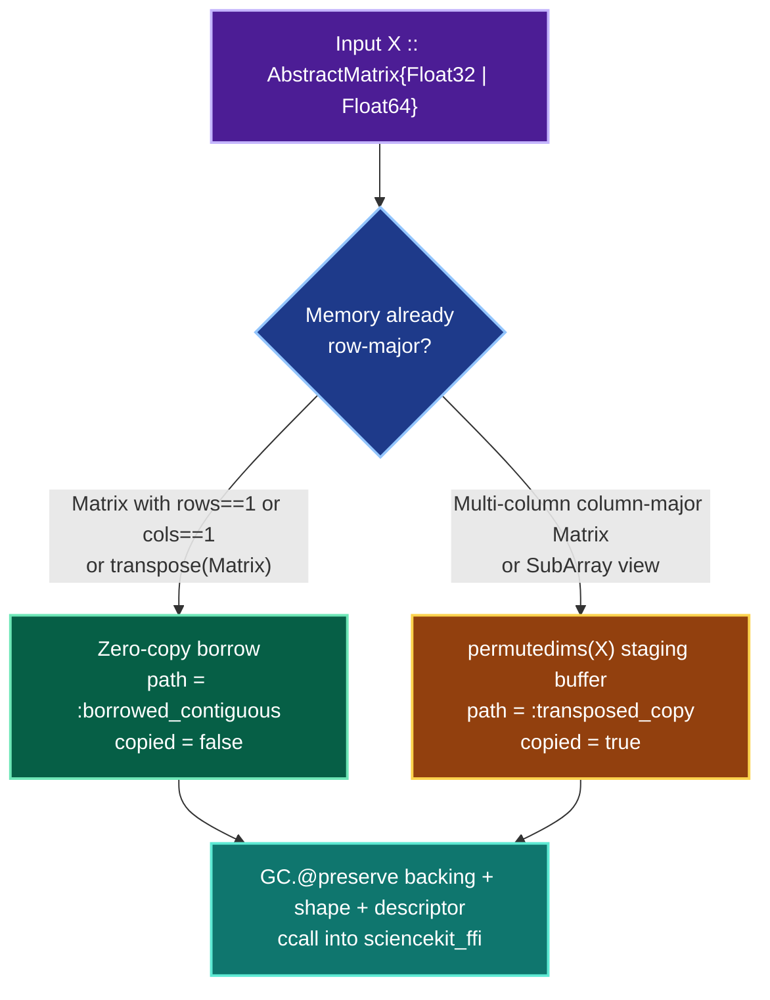

# Dense Matrices & Layout Rules

Julia arrays use **column-major** (Fortran) memory order, whereas `sciencekit_ffi` validates **row-major** (C-contiguous) descriptors (`SKFfiArray`). `ScienceKit.jl` handles this boundary transparently and reports whether a buffer was borrowed directly or transposed.



## Inspecting conversion behavior

Use `inspect_matrix_conversion` and `inspect_vector_conversion` (tested in `test/arrays_tests.jl`) to audit memory behavior:

```julia
using ScienceKit

# Standard 2x3 column-major Matrix -> transposed into row-major staging buffer
X = [1.0 2.0 3.0; 4.0 5.0 6.0]
r1 = inspect_matrix_conversion(X)
# ConversionReport(:transposed_copy, (2, 3), Float64, true)

# Single-column 3x1 Matrix -> borrowed zero-copy!
X_col = reshape([10.0, 20.0, 30.0], 3, 1)
r2 = inspect_matrix_conversion(X_col)
# ConversionReport(:borrowed_contiguous, (3, 1), Float64, false)

# transpose(Matrix) where parent has shape (cols, rows) -> borrowed zero-copy!
X_parent = [1.0 4.0; 2.0 5.0; 3.0 6.0]
r3 = inspect_matrix_conversion(transpose(X_parent))
# ConversionReport(:borrowed_contiguous, (2, 3), Float64, false)
```

## Element type & shape validation

- **Supported element types:** `Float64` (`DTYPE_F64`) and `Float32` (`DTYPE_F32`). Passing `Matrix{Int64}` raises `ScienceKitError(STATUS_INVALID_ARGUMENT, ...)` suggesting `Float64.(X)` or `Float32.(X)`.
- **Non-empty dimensions:** Zero-row or zero-column matrices (`zeros(0, 2)`) and empty vectors (`Float64[]`) raise `ScienceKitError(STATUS_SHAPE, ...)`.
- **`GC.@preserve` discipline:** Every native call pins the backing `Array{T}`, the `Int64` shape vector, and the `Ref{FfiArrayDescriptor}` for the entire duration of the `ccall`.
