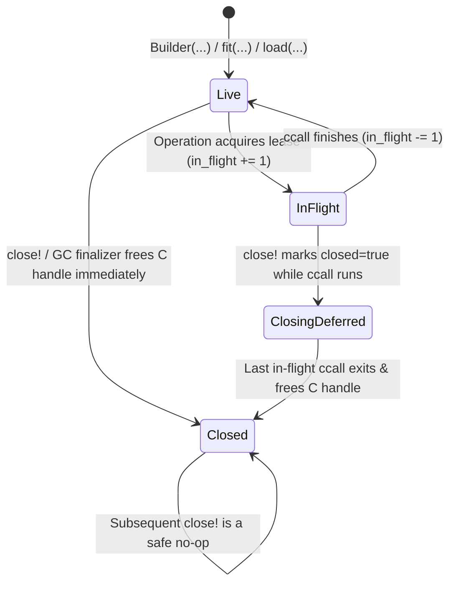

# Handle Lifecycle & GC Safety

Every `Builder` and `Model` owns an opaque handle in `sciencekit_ffi`'s Rust handle registry. Managing those handles safely in Julia requires solving three problems simultaneously:

1. **No use-after-free:** Calling `predict` or `fit` after `close!` (or concurrently with `close!`) must never dereference freed C memory.
2. **Idempotent `close!`:** Calling `close!(model)` twice must be a harmless no-op rather than freeing the handle twice.
3. **GC finalizer safety:** Julia forbids task switching (`ReentrantLock`) inside garbage-collector finalizers.

## SpinLock lease state machine

`ScienceKit.jl` protects each wrapper with a non-yielding `Threads.SpinLock` and an `in_flight` lease counter:



- When `close!` runs with `in_flight == 0`, the native `sk_ffi_*_free` call runs immediately and `live_handle_count()` decrements by 1.
- When `close!` runs while another thread is mid-`ccall` (`in_flight > 0`), `closed` becomes `true` immediately (rejecting any new callers with `STATUS_INVALID_HANDLE`), and the exiting `ccall` releases the native handle in its `finally` block.
- Native output descriptors (`SKFfiArray`) returned by `sk_ffi_predict` and `sk_ffi_transform` are copied into Julia-managed `Vector` or `Matrix` storage inside a `try ... finally` block that always calls `sk_ffi_array_free`.

## Verifying zero handle leaks

`live_handle_count()` exposes the atomic process-wide count of live handles, used in `test/lifecycle_tests.jl` and `test/persistence_and_errors_tests.jl`:

```julia
using ScienceKit

baseline = live_handle_count()

builder = linear_regression_builder()
model = fit(builder, Float64[0 0; 1 2], Float64[1, 5])
@assert live_handle_count() == baseline + 2

close!(model)
close!(model)   # idempotent second call
close!(builder)
@assert is_closed(model) && is_closed(builder)
@assert live_handle_count() == baseline
```
